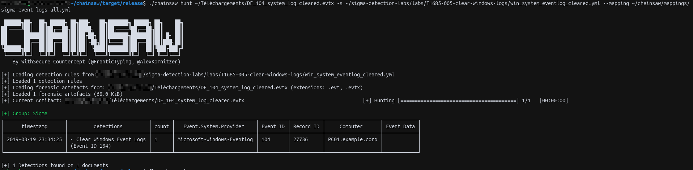

# Samples

The `.evtx` files in this folder come from the
[EVTX-ATTACK-SAMPLES](https://github.com/sbousseaden/EVTX-ATTACK-SAMPLES)
repository by Samir Bousseaden, and are distributed under the
GNU General Public License (see `LICENSE` in this folder).

They are used here only to test the Sigma rules of this project.
The rules themselves are not covered by this license.

## Chainsaw Tests
> My chainsaw executable is in the ./chainsaw/target/realease/ folder

```
./chainsaw hunt <FileToAnalyze_Path> -s <RuleFileYML_Path> --mapping <MappingFileYML_Path>
```
1. `win_system_eventlog_cleared.yml` Chainsaw Test
.evtx file : `labs/T1685-005-clear-windows-logs/samples/DE_104_system_log_cleared.evtx` [here](labs/T1685-005-clear-windows-logs/samples/DE_104_system_log_cleared.evtx)



3. `win_security_eventlog_cleared.yml` Chainsaw Test
For the `win_security_eventlog_cleared.yml` file test, we need to modify certain parts of the file (see the comments in the modified file below):

```
title: Clear Windows Security Event Log (Event ID 1102)
id: e0fbf6b3-40d9-4e7b-b703-23de9e5a2b62
name: detect_clear_windows_security_event_log
status: experimental
description: Detects the clearing of the Windows Security event log by monitoring for Event ID 1102. Unlike other Windows logs that generate Event ID 104 in the System log when cleared, the Security log is isolated and generates its own specific audit event.
author: Sebastien Xia
references:
  - https://attack.mitre.org/techniques/T1685/005/
date: 2026-11-09
logsource:
  product: windows
 # The "service: security" has been temporarily removed to ensure compatibility with Chainsaw
detection:
  selection:
    EventID: 1102
    Channel: Security # We manually filter the channel here to compensate for the absence of the logsource
  condition: selection
fields:
  - SubjectUserName
  - SubjectDomainName
  - SubjectLogonId
falsepositives:
  - Legitimate administrative cleanup (very rare in modern enterprise environments, should always be investigated).
level: high
tags:
  - attack.t1685.005
  - attack.defense_impairment
```
