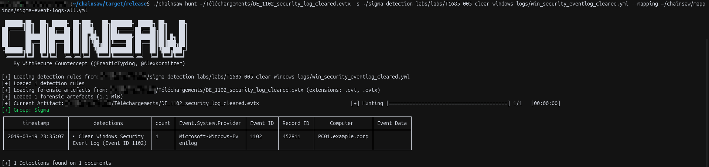

## Chainsaw Test
* `win_security_eventlog_cleared.yml` Chainsaw Test
For the `win_security_eventlog_cleared.yml` file test, we need to modify certain parts of the file (see the comments in the modified file below):

```
title: Clear Windows Security Event Log (Event ID 1102)
id: e0fbf6b3-40d9-4e7b-b703-23de9e5a2b62
name: detect_clear_windows_security_event_log
status: experimental
description: Detects the clearing of the Windows Security event log by monitoring for Event ID 1102. Unlike other Windows logs that generate Event ID 104 in the System log when cleared, the Security log is isolated and generates its own specific audit event.
author: Sebastien Xia
references:
  - https://attack.mitre.org/techniques/T1685/005/
date: 2026-11-09
logsource:
  product: windows
 # The "service: security" has been temporarily removed to ensure compatibility with Chainsaw
detection:
  selection:
    EventID: 1102
    Channel: Security # We manually filter the channel here to compensate for the absence of the logsource
  condition: selection
fields:
  - SubjectUserName
  - SubjectDomainName
  - SubjectLogonId
falsepositives:
  - Legitimate administrative cleanup (very rare in modern enterprise environments, should always be investigated).
level: high
tags:
  - attack.t1685.005
  - attack.defense_impairment
```




## Splunk Test
* `win_security_eventlog_cleared.yml` Splunk Test

Unlike the Chainsaw test, **the original rule is used unmodified**: the custom pipeline does not use the `logsource` section, so `service: security` can stay in the rule.

Splunk on Linux cannot read `.evtx` files, and the field names of a Sigma rule (`EventID`, `SubjectUserName`...) do not match the fields of the converted JSON (`Event.System.EventID`...). The test therefore has two conversions:

```
.evtx  ──(evtx2jsonl.py)──>  .jsonl  ──(Upload)──>  Splunk, sourcetype evtx:json
.yml   ──(sigma convert + custom pipeline)──>  SPL query  ──>  run in Splunk
```

### Prerequisites

```bash
python3 -m venv ~/venv-evtx
source ~/venv-evtx/bin/activate
pip install evtx sigma-cli
sigma plugin install splunk
```

### Step 1: convert the `.evtx` file to JSON Lines

```bash
python tools/evtx2jsonl.py \
  labs/T1685-005-clear-windows-logs/samples/DE_1102_security_log_cleared.evtx \
  security_cleared.jsonl
```

### Step 2: ingest the file in Splunk

In *Settings → Add Data → Upload*, select `security_cleared.jsonl`, then select the `evtx:json` sourcetype (created during the `win_system_eventlog_cleared.yml` test). If it does not exist yet, create it from `Structured → _json` with these settings and *Save As* → `evtx:json`:

| Setting | Value |
|---|---|
| Timestamp → Extraction | Advanced |
| Time zone | UTC / GMT (the timestamp ends with `Z`) |
| Timestamp format | `%Y-%m-%dT%H:%M:%S.%7NZ` |
| Timestamp fields | `Event.System.TimeCreated.#attributes.SystemTime` |
| Advanced → `MAX_DAYS_AGO` | `10951` |

Check that `_time` shows the original date of the event, then submit.

### Step 3: convert the Sigma rule with the custom pipeline

Event 1102 stores the same `LogFileCleared` structure as event 104, under `UserData`. The pipeline [`pipelines/evtx_json.yml`](pipelines/evtx_json.yml) maps the fields used by this rule and adds `sourcetype="evtx:json"` to the query:

| Sigma field | Field in Splunk (`evtx:json`) |
|---|---|
| `EventID` | `Event.System.EventID` |
| `Channel` | `Event.System.Channel` |
| `SubjectUserName` | `Event.UserData.LogFileCleared.SubjectUserName` |
| `SubjectDomainName` | `Event.UserData.LogFileCleared.SubjectDomainName` |
| `SubjectLogonId` | `Event.UserData.LogFileCleared.SubjectLogonId` |

```bash
sigma convert -t splunk -p pipelines/evtx_json.yml \
  labs/T1685-005-clear-windows-logs/win_security_eventlog_cleared.yml
```

Output:

```
sourcetype="evtx:json" Event.System.EventID=1102 Event.System.Channel="Security" | table Event.UserData.LogFileCleared.SubjectUserName,Event.UserData.LogFileCleared.SubjectDomainName,Event.UserData.LogFileCleared.SubjectLogonId
```

> Do not add `-p splunk_windows`: it renames `EventID` to `EventCode` before the custom pipeline runs, and the mapping no longer applies.

### Step 4: run the query in Splunk

Paste the query in *Search & Reporting* with the time range set to **All time** (add `index=<your_index>` at the beginning if the file was not indexed in `main`). The query returns the account that cleared the Security log, its domain and its logon ID. The logon ID can then be used to find the matching logon session (Event ID 4624).
