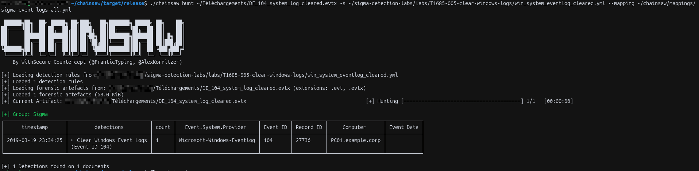

## Chainsaw Tests
> My chainsaw executable is in the ./chainsaw/target/realease/ folder

```
./chainsaw hunt <FileToAnalyze_Path> -s <RuleFileYML_Path> --mapping <MappingFileYML_Path>
```
1. `win_system_eventlog_cleared.yml` Chainsaw Test
.evtx file : `labs/T1685-005-clear-windows-logs/samples/DE_104_system_log_cleared.evtx` [here](labs/T1685-005-clear-windows-logs/samples/DE_104_system_log_cleared.evtx)





## Splunk Tests

### Why a conversion is needed

Testing a Sigma rule in Splunk from a Linux machine raises two problems:

1. **Splunk on Linux cannot read `.evtx` files.** Native Windows event log ingestion only works through the Windows API. The `.evtx` file must first be converted to JSON Lines (one event per line).
2. **The field names do not match.** A Sigma rule uses generic field names (`EventID`, `Provider_Name`...). Once converted, the JSON keeps the original XML structure of the event, so the same field becomes `Event.System.EventID`. The standard `splunk_windows` pipeline of sigma-cli does not help either: it targets logs collected by the Splunk Universal Forwarder (`EventCode`, `source="WinEventLog:System"`).

The workflow is therefore:

```
.evtx  ──(evtx2jsonl.py)──>  .jsonl  ──(Upload)──>  Splunk, sourcetype evtx:json
.yml   ──(sigma convert + custom pipeline)──>  SPL query  ──>  run in Splunk
```

### Prerequisites

```bash
python3 -m venv ~/venv-evtx
source ~/venv-evtx/bin/activate
pip install evtx sigma-cli
sigma plugin install splunk
```

- `evtx`: Python bindings of the Rust EVTX parser, used to convert `.evtx` files to JSON.
- `sigma-cli` + the `splunk` plugin: converts Sigma rules to SPL.

### 1. `win_system_eventlog_cleared.yml` Splunk Test

**Step 1: convert the `.evtx` file to JSON Lines**

```bash
python tools/evtx2jsonl.py \
  labs/T1685-005-clear-windows-logs/samples/DE_104_system_log_cleared.evtx \
  system_cleared.jsonl
```

**Step 2: ingest the file in Splunk**

In *Settings → Add Data → Upload*, select `system_cleared.jsonl`, then on the *Set Source Type* page:

| Setting | Value |
|---|---|
| Source type | `Structured → _json` |
| Timestamp → Extraction | Advanced |
| Time zone | UTC / GMT (the timestamp ends with `Z`) |
| Timestamp format | `%Y-%m-%dT%H:%M:%S.%7NZ` |
| Timestamp fields | `Event.System.TimeCreated.#attributes.SystemTime` |
| Advanced → `MAX_DAYS_AGO` | `10951` |

`MAX_DAYS_AGO` is required because the samples date from 2019: by default, Splunk rejects timestamps older than 2000 days and falls back to the file modification time.

Click *Apply settings*, check that `_time` shows the original date of the event, then *Save As* → `evtx:json` so the sourcetype can be reused for the other samples.

**Step 3: convert the Sigma rule with the custom pipeline**

The pipeline [`pipelines/evtx_json.yml`](pipelines/evtx_json.yml) maps the Sigma field names to the field names of the converted JSON, and adds `sourcetype="evtx:json"` to every query:

| Sigma field | Field in Splunk (`evtx:json`) |
|---|---|
| `EventID` | `Event.System.EventID` |
| `Provider_Name` | `Event.System.Provider.#attributes.Name` |
| `UserData_LogFile` | `Event.UserData.LogFileCleared.Channel` |
| `SubjectUserName` | `Event.UserData.LogFileCleared.SubjectUserName` |

```bash
sigma convert -t splunk -p pipelines/evtx_json.yml \
  labs/T1685-005-clear-windows-logs/win_system_eventlog_cleared.yml
```

Output:

```
sourcetype="evtx:json" Event.System.EventID=104 "Event.System.Provider.#attributes.Name"="Microsoft-Windows-Eventlog" | table Event.UserData.LogFileCleared.Channel,Event.UserData.LogFileCleared.SubjectUserName
```

> Do not add `-p splunk_windows`: it renames `EventID` to `EventCode` before the custom pipeline runs, and the mapping no longer applies.

**Step 4: run the query in Splunk**

Paste the query in *Search & Reporting* with the time range set to **All time** (add `index=<your_index>` at the beginning if the file was not indexed in `main`). The cleared log (`System`) and the user who cleared it (`user01`) are returned.


